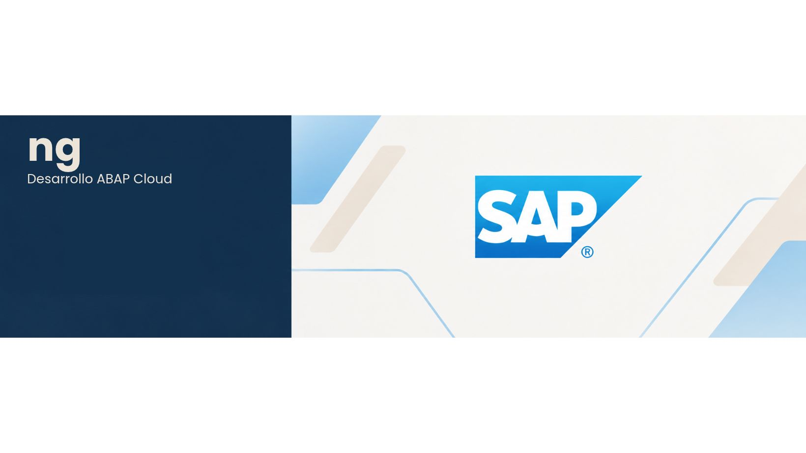

<!-- Encabezado con banner -->

  

# 👋 ¡Hola! Soy Natalia / Desarrolladora Backend con base Frontend

➡️ Actualmente estoy construyendo mi perfil como desarrolladora SAP ABAP Cloud dentro del ecosistema SAP BTP, mientras continúo reforzando mis conocimientos en otras tecnologías backend como: Java y Spring Boot. 
➡️ Mi objetivo es aprender a diseñar e implementar soluciones eficientes, mantenibles y escalables, así como participar en proyectos de mantenimiento y evolutivos.
➡️ Mi trayectoria profesional en la gestión y producción de proyectos culturales me ha permitido desarrollar competencias en planificación, organización, coordinación de equipos y resolución de incidencias. Hoy traslado esa experiencia al ámbito tecnológico, con una visión estructurada y orientada a la calidad, la lógica de negocio y las buenas prácticas de desarrollo.

✅ ¿Qué puedo aportar como desarrolladora junior?

🔹Organización, responsabilidad y autonomía en el trabajo.
🔹Capacidad de aprendizaje, adaptación y mejora continua.
🔹Atención a la calidad del código, la limpieza y la documentación.
🔹Habilidades comunicativas y capacidad para trabajar en equipo.
🔹Mentalidad analítica, orientación a soluciones y motivación por aprender de profesionales con experiencia.

📌Busco crecer profesionalmente en un entorno colaborativo, especialmente enfocado en el ecosistema SAP, donde pueda consolidar mis conocimientos, asumir nuevos retos y contribuir al desarrollo de soluciones que aporten valor.

---

## 🛠️ Tech Stack

### 🔹Backend

  

### 🔹 Frontend

  

### 🔹 Bases de datos

  

### 🔹 Herramientas

  

---

## 🚀 Mis Primeros Proyectos 

### 🔸 E-Commerce Rännkor
- Arquitectura MVC
- PHP/MySQL/HTML/CSS/JS
- Boceto tienda E-Commerce de venta de zapatillas
- Vista usuario y panel administrador
- Funciones Usuario: login, crear cuenta, navegación por categorías, carrito, simulación de compra, ver pedidos realizados, ver perfil.
- Funciones Adminisitrador: login, gestión de productos, gestión de pedidos.
- URL: https://rannkor.infinityfreeapp.com/

### 🔸 Aplicación Gestfincas
- Arquitectura MVC 
- PHP/MySQL/HTML/CSS/BOOTSTRAP/JS
- Trabajo en prácticas FP
- Desarrollo aplicación gestión de comunidad de vecinos
- Funciones Usuario: crear cuenta, login, acceso a módulos: reservas, parking, finanzas, juntas, votaciones, foro, incidencias, perfil, notificaciones.
- Funciones Presidente: alta vivienda, gestión de cada uno de los módulos para auditar y gestionar problemas en la comunidad.
- Funciones Administrador: crear comunidades, dar de alta presidente, acceso a la aplicación completa.

### 🔸 Certificaciones SAP en proceso
- ABAP CLOUD
- CAP
- CPI

---

---

## 🌐 Conecta conmigo

  
  

---

  

